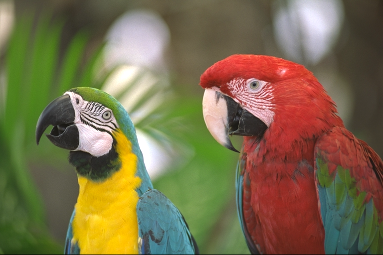
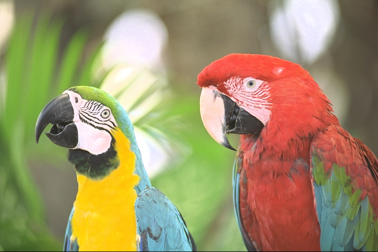

[日本語](README_ja.md)

# libhdrgrading

**[Try it in your browser (demo)](https://zeriyoshi.github.io/libhdrgrading/demo/)**: converts an SDR image of your own to HDR inside the browser (WebAssembly) and compares it with the original (the image never leaves the page).

**[Documentation](https://zeriyoshi.github.io/libhdrgrading/)**: manuals in English and Japanese, and the API reference.

<table>
  <tr>
    <th>SDR (the original)</th>
    <th>HDR (libhdrgrading's default output: a gain map JPEG)</th>
  </tr>
  <tr>
    <td></td>
    <td></td>
  </tr>
</table>

On an HDR display, in a browser that reads gain maps (Chrome, for example), the right image shows its lights and highlights brighter. Elsewhere it shows as SDR. The image is kodim23 from the Kodak Lossless True Color Image Suite, converted with the default settings (`build/dev/hdrg-cli assets/kodim23.png out.jpg`).

A general-purpose C11 library that grades SDR images (JPEG / PNG / GIF / AVIF) into HDR that looks
naturally brighter on HDR displays, and writes it with standard HDR signaling (ISO 21496-1 gain maps,
PQ / cicp, HAGC) to JPEG, JPEG XL, or 10-bit AVIF and HEIF.

**The default output is an SDR-based gain map JPEG** (ISO/TS 21496-1): the true SDR image is the
base, with a monochrome gain map attached through MPF (alongside Apple HDRGainMap XMP and hdrgm XMP /
GContainer). Environments that read gain maps (iOS 18+ / macOS 15+, Android 15+, Chrome,
libultrahdr-based ones) show it as HDR, and every other environment still shows the correct SDR.

`--hybrid` writes PQ pixels with a "P3 PQ" ICC/cicp as the primary, plus a gain map that restores
the SDR (the HDR-based direction). It is HDR even where only the ICC is read, but SDR viewers without
color management show it dark, and libultrahdr-based readers reject the HDR-based direction. `--pq`
is a plain single-layer PQ without a gain map.

Codec plugins read and write the file formats (`hdrg_context_set_writer` picks the writer; hdrg-cli
uses `--format` or the output's extension, and `--format-opt key=value` for its settings).

`--jxl` (or an output extension of .jxl) writes JPEG XL (the bundled libjxl, built in by default). The default form is hybrid:
a 16-bit PQ base (BT.2100, with the intensity target at the rendering peak) and a gain map back to SDR (an 8-bit gray
codestream in a jhgm box with ISO 21496-1 metadata). It also writes the gain map form and single-layer PQ.

`--avif` (or an output extension of .avif) writes the same three forms as 10-bit AV1 AVIF: the gain map form is
a 10-bit SDR base plus an ISO 21496-1 gain map, and the base of hybrid and single-layer PQ is PQ in a BT.2020 container
(CICP 9/16/9, with MaxCLL / MaxFALL). Color is carried by CICP, so no ICC is attached. AVIF input is read too.
AVIF is a loadable module on top of the system libavif (pkg-config, 1.2 or later) (`HDRG_WITH_AVIF`, off by default and opt-in like HEIF;
turning it on is at your own risk: see "About the options off by default" below), not linked into the library (hdrg-cli and hdrg-gui load the modules next to them).

`--heif` (or an output extension of .heic / .heif) writes the same three forms as 10-bit HEVC HEIF (opt-in:
`-DHDRG_WITH_HEIF=ON`, a loadable module on top of libheif; turning it on is at your own risk: see "About the options off by default" below). The gain map form carries both the ISO 21496-1 tmap and
Apple's HDR gain map auxiliary image, and Apple's ImageIO reads both. HEIF is written only, never read.
libheif and the HEVC codecs are not bundled: the system libheif is used, or else libde265, x265 and
libheif are fetched at build time and built as shared libraries (x265 is GPL-2.0, so distributing a module that
contains it falls under the GPL's terms).

- By default, two layers: a diffuse gain and a light boost. The whole picture is lifted by one gain (`--diffuse-max`, at most 2× = about 400 nits for bright pictures; dark and low-key pictures stay at the SDR level), keeping the ratios between surfaces as they are in the SDR. Only regions with the cues of a light source or a specular highlight (surroundings that fall off smoothly and alike in every direction = a glow) stretch up to the peak. White walls, documents, snow, text and UI stay diffuse. The average luminance is held to 25% of the peak (`--apl-peak-fraction`, BT.2408; `--apl-budget` adds an absolute cap). The peak is the gain map's declared 3 stops (`--gm-cap`, about 1624 nits), or 1000 nits for --hybrid / --pq. The luminance boost sits on a grid with luminance bins, so no halo spreads outside the edges. Stills use the quality mode (`--effort quality`, the default), which also treats small sparkles that 4 × 4 cells cannot see as lights. Video sessions default to real time (`realtime`) for viewing (PLAYBACK, LOW) and to quality for file conversion (OFFLINE). Everything is luminance-ratio scaling, so hue is structurally unchanged
- Grading (contrast / local contrast / saturation / soft shoulder) applies on top. A shadow floor keeps every pixel from getting darker than the SDR original
- Input color is resolved as primaries + transfer characteristics (ICC matrix + TRC and v4.4 cicp, EXIF Adobe RGB (R03), PNG cICP / cHRM / gAMA; LUT-based ICC through lcms2). Wide-gamut input such as Adobe RGB / BT.2020 / ProPhoto is not crushed into sRGB
- The gamut is used through a boundary-relative mapping in Oklab LCh (`--expand`): only saturated colors near the boundary of the input gamut stretch toward the width of Display P3, while achromatic colors, skin, pastels and memory colors (sky, plants) are kept. Saturation (`--saturation`) is applied within the same mapping, keeping L and hue, and baked into a 3D LUT for the apply. Analysis runs on the source values
- Presets (`--preset photo|anime|game`): different starting points of the same pipeline (strength and protection of the gamut expansion, the default `--sdr-eotf` (γ2.2 for anime and game), highlight desaturation, prefilters and chroma fitting)
- The PQ ICC of `--hybrid` / `--pq` carries a HAGC tag (an SMPTE ST 2094-50 gain curve), so even a path that keeps only the ICC carries a curve (measured during the apply) that restores the original SDR on low-headroom displays (not yet verified on devices; `--no-hagc` turns it off)
- Deterministic output: same input + same parameters → byte-identical for the same build and the same SIMD tier (whatever the thread count). Across tiers and OSes the output agrees within a tolerance, and the encoded bytes are outside the guarantee (JPEG and JPEG XL may depend on the CPU. AVIF changes with the version of the system libaom and, for some versions, with the thread count: the writer's `threads=1` makes it the same at any thread count with the same libaom)
- SIMD: the CPU is probed at run time to choose the SSE4.1 / AVX2 / NEON kernels (WASM decides between SIMD128 and scalar at build time). The environment variable `HDRG_SIMD_MAX` (`scalar` / `sse41` / `avx2` / `neon` and so on) caps the choice, and the chosen tier appears in `--stats`. AVX-512 / SVE are provisional and used only with `HDRG_SIMD_MAX=avx512` / `sve`. The default build fuses multiply-adds (FMA) in the SIMD kernels and agrees with scalar within a tolerance. With `-DHDRG_WITH_SIMD_FMA=OFF` (the default of the Debug presets), every tier is byte-identical to scalar

## Building

```sh
git clone <repo> && cd libhdrgrading
scripts/fetch_deps.sh              # fetch the third_party submodules (CMake does the build)
cmake --workflow --preset dev      # configure + build + test
```

WASM (Emscripten, with the development image's emsdk):

```sh
scripts/docker_dev.sh bash -c 'source "$HDRG_EMSDK_DIR/emsdk_env.sh" && cmake --workflow --preset wasm'
scripts/docker_dev.sh scripts/wasm_demo.sh             # the site in build/web: the docs and the demo of the five modules
```

The presets are `wasm` (SIMD128, single thread) / `wasm-mt` (pthreads) / `wasm-scalar` / `wasm-scalar-mt` / `wasm-webgpu` (GPU prefilters through the browser's WebGPU, JSPI) / `wasm-debug`. The tests run on node.
The demo (`src/wasm/demo/`) is published on GitHub Pages together with the docs (`docs/`).

For the presets (sanitizers / valgrind / coverage / fuzz), the DevContainer and CI, see `CONTRIBUTING.md` (in Japanese).
The main CMake options (`HDRG_WITH_<name>` names dependencies, backends and built-in features, `HDRG_BUILD_<name>` things built next to the library): `HDRG_WITH_LCMS2` (default ON; without it the JPEG XL writer family jxl is dropped), `HDRG_WITH_AVIF` (default OFF; the AVIF module on the system libavif: `brew install libavif` on macOS, `libavif-dev` on Debian; preset `avif`), `HDRG_WITH_HEIF` (default OFF; the HEIF module on the system libheif or one fetched at build time; preset `heif`), `HDRG_WITH_SIMD` (default ON), `HDRG_WITH_SIMD_FMA` (default ON, OFF in the Debug presets), `HDRG_WITH_TEMPORAL` (default OFF; ON enables the temporal features of video: the temporal statistics filter (window, RECURSIVE, TWO_PASS), motion-compensated frame interpolation hdrg.interp.mc and multi-frame upscaling hdrg.scale.temporal, individually `HDRG_WITH_TEMPORAL_FILTER` / `_INTERP` / `_SR`), `HDRG_PLUGINS_EXCLUDE` (default empty = everything built in; a list of the built-in plugin families to drop: bilinear, denoise, deblock, dering, defringe, deband, mctf, interp, fsr, nis, edge, predict and the codecs jpeg, png, gif, jxl, or the groups `filters`, `codecs`, `all`. polyphase cannot be dropped. A codec brings its own dependencies. The preset `minimal` keeps only Lanczos and JPEG), `HDRG_BUILD_TOOLS/TESTS/FUZZERS`,
`HDRG_SANITIZER`, `HDRG_COVERAGE`, `HDRG_WITH_WEBGPU` (GPU prefilters; ON when Dawn is found. `scripts/build_dawn.sh`
builds Dawn from source at the pinned tag: into `build/deps/dawn` on macOS, while the development image has it in
`/opt/dawn`). The JPEG implementation is fixed to jpegli (commit pin).
On Apple, `HDRG_WITH_METAL` (default ON) adds the Metal prefilters and MetalFX upscaling (the shaders are MSL that `scripts/gen_shaders.sh` generates from WGSL with the Tint CLI; `scripts/build_dawn.sh --tint` builds the CLI).
On Linux and elsewhere, `HDRG_WITH_VULKAN` (default ON when the Vulkan headers are present) adds the Vulkan prefilters, apply and input conversion (the loader is opened at run time, so nothing is linked; the shaders are Tint's SPIR-V likewise). It also accepts the app's VkDevice and frames in VkBuffers and dma-bufs.

**About the options off by default**: `HDRG_WITH_TEMPORAL` (and `HDRG_WITH_TEMPORAL_FILTER` / `_INTERP` / `_SR`), `HDRG_WITH_AVIF` and `HDRG_WITH_HEIF` are off by default, since we cannot say for certain that using them is safe with regard to third-party rights.
If you turn them on, you do so at your own risk, and you build it yourself. The presets `temporal`, `avif`, `heif` and the coverage presets turn them on for this project's own verification, and CMake reports a configuration that turns them on when it configures.

### Installing and using the library

```sh
cmake -B build/out -DCMAKE_BUILD_TYPE=Release -DBUILD_SHARED_LIBS=ON   # OFF (the default) for static
cmake --build build/out
cmake --install build/out --prefix /usr/local
```

- The library is the single `libhdrgrading`. It contains the objects of the built-in plugins (`src/plugins`: the filter families and the JPEG, PNG, GIF and JPEG XL codecs) and of the bundled dependencies (jpegli, Highway, libpng, zlib, giflib, lcms2, libjxl, brotli). AVIF and HEIF are loadable modules (`<libdir>/hdrgrading`).
  Plugin projects can also be built separately against the installed package (`hdrgrading::headers`, `foundation`, `gpu`, `plugin_shared`, `hdrg_plugin`).
  The shared library (`BUILD_SHARED_LIBS=ON`, the `release` preset) exports only the `HDRG_API` functions of the public headers, and no symbol of the dependencies leaks out.
  The static library (`libhdrgrading.a`) contains the dependencies' symbols as they are, so in an app that also links another libpng / zlib statically
  the symbols may clash. In that case, use the shared library or `HDRG_WITH_SYSTEM_DEPS=ON` (the system zlib / libpng / giflib / lcms2).
- Memory: every allocation of the library, the built-in plugins, the GPU layer, libpng, lcms2 and
  plugins (the API table's `mem_*`) goes through the allocator passed in `hdrg_context_desc_t.allocator` (jpegli, giflib, Highway, the C++ parts of libjxl and the GPU drivers allocate on their own).
  The default used when none is passed can be replaced at build time with `-DHDRG_MEMORY_HEADER=<header>` (a header defining macros such as `HDRG_MALLOC`).
- Versions stay at 0.x until the API is frozen (SOVERSION 0, `libhdrgrading.so.0`). During 0.x, a minor bump breaks compatibility.
- Consumers use the CMake package or pkg-config (both keep working after the install location is moved):

```cmake
find_package(hdrgrading 0.0.1 REQUIRED)
target_link_libraries(app PRIVATE hdrgrading::hdrgrading)
```

```sh
cc app.c $(pkg-config --cflags --libs hdrgrading)            # shared
cc app.c $(pkg-config --cflags --libs --static hdrgrading)   # static (adds the C++ runtime and so on)
```

- What gets installed: the headers (`include/hdrgrading/`), the library, the CMake package (`lib/cmake/hdrgrading/`),
  `lib/pkgconfig/hdrgrading.pc`, the tools (`hdrg-cli`, `hdrg-video`, `hdrg-inspect`, and `hdrg-ffmpeg` when built),
  the GStreamer (`lib/gstreamer-1.0/`) and VapourSynth (`lib/vapoursynth/`) plugins, and the licenses (`share/doc/hdrgrading/`,
  the bundled dependencies' as well). `HDRG_INSTALL=OFF` leaves them out (the default when included as a subproject).

## Usage

```sh
build/dev/hdrg-cli --stats input.jpg output.jpg     # SDR-based gain map JPEG (the default)
build/dev/hdrg-cli --hybrid input.jpg output_h.jpg  # PQ primary + SDR-restoring gain map
build/dev/hdrg-cli --pq input.jpg output_pq.jpg     # plain single-layer PQ
build/dev/hdrg-cli input.jpg output.avif            # 10-bit AVIF (gain map; --hybrid / --pq too)
build/dev/hdrg-cli --format-opt quality=95 --format-opt chroma=420 input.png output.avif   # writer options: quality (default 90) and 4:2:0
build/dev/hdrg-cli input.jpg output.heic            # 10-bit HEIF (an HDRG_WITH_HEIF build, quality 70 by default)
build/dev/hdrg-cli --preset anime in.png out.jpg    # the starting point for anime (decoded with γ2.2, strong skin protection)
build/dev/hdrg-inspect output.jpg                   # check the HDR signaling (AVIF too)

# Noise reduction (spatial NR in the PREFILTER stage. Off by default: noise is kept, not amplified)
build/dev/hdrg-cli --grain-policy reduce --denoise 1 input.jpg output.jpg
# Removing compression artifacts (PREFILTER stage: blockiness and ringing are measured, and nothing is done without them).
# By default photo / anime deblock, and anime also derings. 0 turns them off
build/dev/hdrg-cli --deblock 0 input.jpg output.jpg
build/dev/hdrg-cli --preset anime --dering 3 input.jpg output.jpg
# Removing false color around edges (color fringing) (PREFILTER stage. 3 by default for anime)
build/dev/hdrg-cli --preset anime --defringe 3 input.jpg output.jpg
# Smoothing the 8-bit steps of gradients (PREFILTER stage. By default photo 0.5, anime 2.5.
# Places with texture or grain are left as they are)
build/dev/hdrg-cli --deband 1 input.jpg output.jpg
# How the chroma of a 4:2:0 JPEG is upscaled (segmented by default for anime: line art gets no color of the neighboring surface)
build/dev/hdrg-cli --chroma-fit segmented input.jpg output.jpg
# Changing the output size (SCALE stage. Without a filter, the built-in scaler: --upscaler when enlarging
# (lanczos / edge / fsr1 / nis; lanczos by default for photo, edge for anime and game), Lanczos when shrinking.
# hdrg.scale.bicubic and hdrg.scale.bilinear through --filter as well. Video can be upscaled with hdrg.scale.temporal,
# which stacks the neighboring frames along the motion (HDRG_WITH_TEMPORAL, at a speed meant for conversions nobody watches live))
build/dev/hdrg-cli --output-size 3840x0 input.jpg output_4k.jpg
# Filter plugins: loading, listing, plugin-specific options
build/dev/hdrg-cli --plugin ./my_scaler.so --list-filters
build/dev/hdrg-cli --plugin ./my_scaler.so --filter scale=org.example.lanczos \
               --filter-opt taps=4 --output-size 3840x0 input.jpg output_4k.jpg
```

Video: converts a y4m pipe to single-layer PQ. `--y4m` writes 4:2:0 10-bit, BT.2020 (non-constant luminance), limited range.

```sh
ffmpeg -i in.mp4 -f yuv4mpegpipe -strict -1 - |
  build/dev/hdrg-video --y4m - - |
  ffmpeg -i - -color_primaries bt2020 -color_trc smpte2084 -colorspace bt2020nc \
    -c:v libx265 out.mp4
```

The input y4m is 4:2:0 / 4:2:2 / 4:4:4 at 8 to 16 bits. `--matrix` sets the matrix (chosen from the primaries by default).
At the end, MaxCLL / MaxFALL and the mastering display are printed in the form of x265's options (`--master-display` / `--max-cll` and the color settings).
Per-frame HDR10+ can be written as hdr10plus_tool's JSON with `--hdr10plus-json plus.json` (x265's `--dhdr10-info plus.json` puts it straight into SEI). The ST 2094-50 gain curve is written with `--st2094-50-json` as a JSON of our own (the fields and the T.35 payload in hex).
The temporal statistics filter (the `--past` / `--future` window, `recursive`, `two-pass`), motion-compensated interpolation and multi-frame upscaling are available in a `-DHDRG_WITH_TEMPORAL=ON` build (the preset `temporal`) (turning them on is at your own risk: see "About the options off by default" above. The default build renders each frame with its own statistics, and its interpolation is only repeat and blend. The `--future` / `past=` / `future=` in the examples below are for that build as well).
With the real-time effort (the default of `--latency playback` / `low`, or `--effort realtime`), analysis runs on a proxy reduced to a long side of `--proxy` (default 960) or less (`--proxy 0` for full resolution). The quality effort (the default under the default `--latency offline`) analyzes at full resolution (hdrg-ffmpeg as well). The temporal mode of the statistics is `--temporal windowed|recursive|two-pass|static` (two-pass reads the input file twice; static is a fixed mapping without statistics).
The static mapping can be exported as a 3D LUT (.cube) with `build/dev/hdrg-video --export-lut out.cube` (for FFmpeg's `lut3d` and the like).
A flash limiter (ITU-R BT.1702-3) works by default, so the lift does not strengthen harmful flashes (`--no-flash-limit` turns it off). Flashes in the source itself are not removed.
`--output-size 3840x0` changes the output size through the SCALE stage (analysis stays at the input size; 0 on one side keeps the aspect ratio).
Listing `--filter prefilter=<id>` (with `--filter-opt key=value`) uses that chain instead of the preset's prefilters. For example, PHOTO's deblock 1 and deband 0.5 with the deband on the GPU: `--filter prefilter=hdrg.deblock --filter-opt strength=1 --filter prefilter=hdrg.webgpu.deband --filter-opt strength=0.5` (an `HDRG_WITH_WEBGPU` build). The listed chain replaces the preset's chain entirely, so the MCTF 1 and spatial NR 1 of PHOTO's video default (where the grain policy AUTO becomes RESYNTH and the removed grain is put back) are not in this example.
In Apple's `HDRG_WITH_METAL` build, `--filter prefilter=hdrg.metal.deband` (the Metal deband) and, for enlarging with `--output-size`, `--filter scale=hdrg.metal.metalfx` (MetalFX Spatial: a separate scaler whose numbers differ from the built-in Lanczos, enlarging only) are available as well.
`--out-rate 60:1` changes the output rate (the frames between the input frames are synthesized with motion compensation; `--filter interp=hdrg.interp.blend` / `hdrg.interp.repeat` as well. Across a cut, the nearer frame. Motion compensation exists only in an `HDRG_WITH_TEMPORAL_INTERP=ON` build; in the default build, give `--filter interp=hdrg.interp.blend` or `repeat`, or the result is `HDRG_ERR_UNSUPPORTED`).
`--gpu auto` runs the GPU versions of the built-in prefilters, upscaling and interpolation, along with the conversion of Y'CbCr input and the session's apply (pass C), on the GPU (Metal, else Vulkan, else WebGPU) (the output is within 1 code of the CPU's. At 4K with 8 threads in PLAYBACK, conversion plus apply drops from about 24 to 9 ms per frame). With WebGPU, and with Metal and Vulkan in LOW, frames stay on the GPU from the conversion to the apply, and the analysis reads back only the proxy and the noise windows. `--gpu filters` puts only the filters on the GPU and keeps the conversion and the apply on the CPU.

Through the API, frames can be sent and outputs received in the app's GPU buffers (Metal's id<MTLBuffer>, WebGPU's WGPUBuffer) or in Apple's pixel buffers (CVPixelBuffer: the output of VideoToolbox's decoders and the pools of its encoders; WebGPU for input only) (`hdrg_session_config_t.device`, `hdrg_device_frame_t`). Y'CbCr input and output also handle interleaved chroma (NV12, P010). hdrg-ffmpeg, with `--hwaccel videotoolbox` and the `*_videotoolbox` encoders, hands the pixel buffers over on the GPU (`--latency playback / low`) or from the CPU without copying. For an app to run the apply on its own GPU, it uses the shaders (`hdrg_shader`: WGSL, SPIR-V, HLSL) and the frame's state (`hdrg_session_receive_state`) (for sessions with nothing that changes the frames; Y'CbCr input takes the conversion shader too).
With `--size`, raw RGB (rgb24 / rgb48le with `--depth 16`) is read, and without `--y4m` raw RGB is written (8-bit with Display P3 primaries by default, `--out-depth 16`, `--bt2020`).

With FFmpeg's development files (libavcodec / libavformat / libswscale 7.0 or later), `hdrg-ffmpeg` is built as well,
turning video files into HDR directly (4:2:0 10-bit PQ / BT.2020 with the mastering display, audio copied).

```sh
build/dev/hdrg-ffmpeg in.mp4 out.mkv                                   # libsvtav1 (else libx265)
build/dev/hdrg-ffmpeg --encoder libx265 --enc-opt crf=18 --future 4 in.mp4 out.mp4
build/dev/hdrg-ffmpeg --set diffuse-max=1.5 --set peak-nits=1000 --max-cll 1000,400 in.mov out.mkv
```

There is also a filter for FFmpeg itself, `libhdrgrading` (a patch to FFmpeg in `src/bindings/ffmpeg/patches`, in a form that can go upstream).
Install the shared libhdrgrading and build FFmpeg with the patch applied.

```sh
cmake --workflow --preset release
cmake --install build/release --prefix build/deps/hdrgrading
scripts/build_ffmpeg.sh --filter build/deps/hdrgrading            # into build/deps/ffmpeg-filter
build/deps/ffmpeg-filter/bin/ffmpeg -i in.mp4 \
  -vf "libhdrgrading=preset=anime:settings='diffuse-max=1.5'" -c:v libsvtav1 out.mkv
```

The output is PQ / BT.2020 in yuv420p10 / p010 / rgb48, with the mastering display and the per-frame HDR10+ and ST 2094-50 attached as frame side data (whether they are written depends on the encoder). For the options, see `ffmpeg -h filter=libhdrgrading`.

With GStreamer's development files (1.20 or later), a plugin with the element `hdrgrade` (`libgsthdrgrading`) is built as well.
Its output is I420_10LE `bt2100-pq`, with the mastering display in the caps. The future window is reported as latency.
Per-frame HDR10+ and ST 2094-50 travel in the buffer's custom meta `HdrgDynamicHdrMeta` (fields `hdr10plus` / `st2094-50`, GstBuffers of the T.35 payloads) (the app reads it through appsink and the like; the standard encoders do not read it).

```sh
GST_PLUGIN_PATH=build/dev gst-launch-1.0 filesrc location=in.mp4 ! decodebin ! videoconvert ! \
  hdrgrade future=4 diffuse-max=1.5 ! x265enc ! h265parse ! matroskamux ! filesink location=out.mkv
```

The properties are `preset` / `temporal` / `latency` (default playback) / `past` / `future` / `proxy` / `flash-limit` / `dither` / `threads` /
`out-rate` (the output rate; the session interpolates the frames between) and the settings by hdrg-cli's option names (`diffuse-max`, `apl-peak-fraction`,
`peak-nits` …, with numeric values; give `preset` first). `preset` / `temporal` / `latency` take the names of their values.

The VapourSynth plugin (`libhdrgrading_vs`, `src/bindings/vapoursynth`) adds `hdrg.Grade`.
Its default is 4:2:0 10-bit BT.2020 PQ (`format="rgb48"` for 16-bit R'G'B'). The input is 8 to 16-bit integer
YUV (4:2:0 / 4:2:2 / 4:4:4) or RGB, and its color is read from the frame properties (`_Matrix` / `_Transfer` / `_Primaries` /
`_ColorRange` / `_ChromaLocation`) (arguments override them). Requesting frames in any order or in parallel gives the same
byte-identical output (only RECURSIVE is approximate; a seek reopens the session `hdrg_session_preroll` frames earlier). The session is always
OFFLINE, so the analysis is at full resolution by default (`proxy` takes effect only when `effort` is set to real time). Pass it to FFmpeg through vspipe's y4m
pipe, or read it with the vapoursynth demuxer of an FFmpeg built with `--enable-vapoursynth`
(give the color settings and the mastering display in the encoder's arguments).

```python
import vapoursynth as vs
core = vs.core
clip = core.bs.VideoSource("in.mp4")  # any source filter
hdr = core.hdrg.Grade(clip, past=8, future=4, preset="photo", diffuse_max=1.5)
hdr.set_output()
```

The arguments are `preset` (`photo` / `anime` / `game`), `temporal` (`windowed` / `recursive` / `static`), `past` / `future` / `proxy`,
`flash_limit` / `dither` (0 / 1), `format` (`yuv420p10` / `rgb48`, `bt2020`: rgb48 is Display P3 by default), color overrides (`matrix` /
`transfer` / `primaries` / `range` / `chromaloc`), the output rate (`fpsnum` / `fpsden`), `threads`, and hdrg-cli's option names
with `-` turned into `_` (`diffuse_max`, `apl_peak_fraction`, `peak_nits`, `sdr_white` …, with numeric values).
The output properties carry the mastering display (`MasteringDisplay*`), the frame's measurements (`HdrgMaxNits` / `HdrgAvgNits`, `HdrgFlashLimited`, `_SceneChangePrev`) and the
T.35 payloads of the dynamic metadata (`HDR10Plus`: the same form as FFMS2 / `HdrgST2094_50`, binary).

For the C API, see `include/hdrgrading/hdrgrading.h`
(`hdrg_params_init(&params, HDRG_PRESET_PHOTO)` fills in the defaults, then `hdrg_convert` /
`hdrg_convert_raw`; the color of raw pixels is given as a pair of `primaries` / `transfer`). Video sessions are in
`include/hdrgrading/video.h`, the app's GPU (device, frames, shaders) in `gpu.h`, the dynamic metadata (HDR10+, ST 2094-50, T.35) in
`metadata.h`, the frame side data (noise, motion, grain) in `sidedata.h`, and the plugin host API in `include/hdrgrading/plugin.h`. The plugin ABI is
`include/hdrgrading/filter.h` (filters, stages) and `include/hdrgrading/codec.h` (codec readers and writers) (at the PoC stage and not frozen: it stays at version 1
and may change incompatibly, so rebuild plugins with headers of the same version). For learned models
running on GPUs or inference runtimes, it offers the following.
- Instances are created only once per conversion or session.
- Asynchronous jobs (ASYNC: submitted and finished with `job_done`. The filter declares `max_inflight`, and the session can keep
  that many in flight).
- Latency profiles (`hdrg_session_config_t.latency`, combined with any preset): `HDRG_LATENCY_PLAYBACK` for watching
  video (the default, delayed by what is in flight), `HDRG_LATENCY_LOW` for uses that need real-time response such as games and calls
  (low-latency mode: submit and wait right away), and `HDRG_LATENCY_OFFLINE` for converting files nobody watches.
  When the processing does not keep up with the rate, the output's `late` says so (OFFLINE does not judge it).
  `hdrg_session_latency_report` returns the latency as frames per cause, frames per profile, milliseconds, the measured processing time and its breakdown
  (conversion, prefilters, analysis, apply), the number of late frames, and recommended changes of settings (`HDRG_ADVICE_*`: GPU or lighter prefilters,
  effort, analysis downscaling, output size, threads, profile). hdrg-video's `--latency offline|playback|low`
  (default offline) prints it at the end.
- Time windows reading the frames before and after, and clips for BasicVSR-style bidirectional models (every N frames from the head of the stream, with overlap;
  also SEQUENTIAL, which keeps state within a clip).
- Negotiation of the job frame format (RGBA16 / planar FP16 / P016 / RGBA8 / RGB10A2 and more).
- Frames allocated by the plugin (IOSurface or pinned memory).
- Handing the app's GPU context over (`hdrg_context_set_device`), and passing frames between adjacent GPU filters
  while they stay on the GPU.
- Replacing the check of the light detection (the ANALYZE stage, `light_predictor`) and the statistics across video frames (the STATS stage).

The GPU devices (WebGPU, Metal, Vulkan) are shared by the library and the plugins of its context. Plugins receive the native device and queue
(and Vulkan's queue lock and WebGPU's device thread) through the API table's `filter_gpu_share`, and the GPU layer they link
(`hdrgrading-gpu`) wraps them in its own objects, so separately built modules run on the same device and queue as well.
Frames on the device are handed over as native buffers too (`hdrgrading/foundation/gpu_share.h`).

## GUI (hdrg-gui)

A tool that opens stills and videos, plays them in an HDR window while every setting of the library can be changed, compares them with the original SDR
by switching or side by side (the original SDR on the left, HDR on the right), and exports them (`tools/gui`, SDL3 + Dear ImGui). On an HDR display it
renders to the headroom of the window.

```sh
cmake --preset dev -B build/gui -DHDRG_BUILD_GUI=ON
cmake --build build/gui --target hdrg-gui
build/gui/hdrg-gui [image or video]
```

- Decoding is the OS's: AVFoundation and ImageIO on macOS, Media Foundation and WIC on Windows,
  GStreamer on Linux.
- Export: stills as JPEG / JPEG XL / AVIF / HEIF (chosen by the format setting or the extension; AVIF and HEIF are the modules next to it). Video as
  HEVC 10-bit PQ (BT.2020) through VideoToolbox (mov / mp4) on macOS and Media Foundation (mp4) on Windows, without audio.
- With `-DHDRG_GUI_MEDIA=ffmpeg` (opt-in), decoding on Linux uses FFmpeg, and video export
  uses the hdrg-ffmpeg next to it (the default encoder libsvtav1, else libx265, audio copied).
  The Linux default (the GStreamer version) does not export video, only stills.
- Linux needs SDL3's X11 / Wayland development packages (the development image has them).

## Dependency updates

Renovate opens update PRs that follow tags (`renovate.json` / `.gitmodules` with
`branch = <tag>`). Dependabot (`.github/dependabot.yml`) updates the GitHub Actions actions and the Docker base images.
An update of an action rewrites the official lockfile
(`.github/workflows/actions.lock`) in the same PR. **Dependencies that neither covers need manual checks:**
- **jpegli** (a commit pin, since it has no release tags) — every quarter, check the main of
  https://github.com/google/jpegli, and update and verify it following the steps in
  CONTRIBUTING.md

## Documentation

- Documentation (English and Japanese, architecture diagrams, the API reference, material for developers): `docs/index.html`. Published on GitHub Pages and
  regenerated with `python3 -I docs/scripts/build.py`
- Development environment, presets, CI, dependencies: `CONTRIBUTING.md` (in Japanese)

## License

Dual-licensed under `Apache-2.0 OR MIT` (choose either `LICENSE-APACHE` or `LICENSE-MIT`).
For the licenses of the bundled third-party components, see `NOTICE`.
