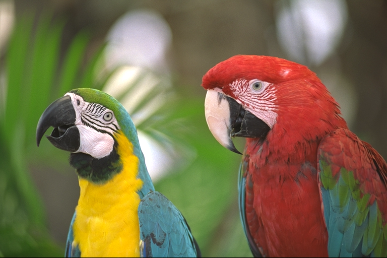
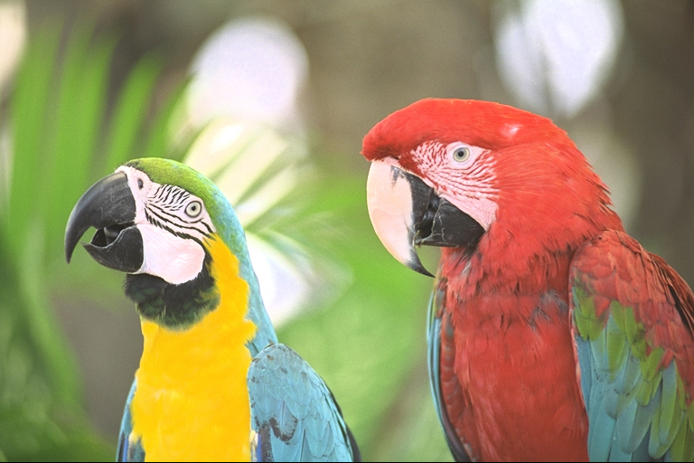

[English](README.md)

# libhdrgrading

**[ブラウザで試す (デモ)](https://zeriyoshi.github.io/libhdrgrading/demo/)**: 手元の SDR 画像を、ブラウザの中 (WebAssembly) で HDR に変換して元の画像と比べられます (画像はページの外へ送られません)。

**[ドキュメント](https://zeriyoshi.github.io/libhdrgrading/)**: 英語と日本語のマニュアル、API リファレンス。

<table>
  <tr>
    <th>SDR (元の画像)</th>
    <th>HDR (libhdrgrading の既定の出力: ゲインマップ JPEG)</th>
  </tr>
  <tr>
    <td></td>
    <td></td>
  </tr>
</table>

右の画像は、HDR ディスプレイとゲインマップに対応したブラウザ (Chrome など) で、光源やハイライトが明るく表示されます。対応しない環境では SDR として表示されます。画像は Kodak Lossless True Color Image Suite の kodim23 (`build/dev/hdrg-cli assets/kodim23.png out.jpg` の既定の設定で変換)。

SDR 画像 (JPEG / PNG / GIF / AVIF) を、HDR ディスプレイで違和感なく明るく見える HDR
へグレーディングし、標準的な HDR シグナリング (ISO 21496-1 ゲインマップ、
PQ / cicp、HAGC) で JPEG・JPEG XL か 10bit の AVIF・HEIF に書き出す汎用の C11 ライブラリ。

**既定出力は SDR ベースのゲインマップ JPEG** (ISO/TS 21496-1): 真の SDR
画像をベースにし、モノクロのゲインマップを MPF で連結する (Apple HDRGainMap
XMP と hdrgm XMP / GContainer も併記)。ゲインマップを読める環境 (iOS 18+ /
macOS 15+、Android 15+、Chrome、libultrahdr 系) は HDR で表示し、それ以外の
環境でも正しい SDR が見える。

`--hybrid` は PQ ピクセル + 「P3 PQ」ICC/cicp のプライマリに SDR 復元用の
ゲインマップ (HDR ベース方向) を付けた形式で、ICC だけを読む環境でも HDR に
なるが、カラーマネジメント非対応の SDR ビューアでは暗く沈み、libultrahdr 系は
HDR ベース方向を拒否する。`--pq` はゲインマップ無しの素の単層 PQ。

ファイルの形式はコーデックのプラグインが読み書きする (`hdrg_context_set_writer` で書き手を選ぶ。hdrg-cli は
`--format` か出力の拡張子、`--format-opt key=value` でその設定)。

`--jxl` (または出力の拡張子 .jxl) で JPEG XL に書く (同梱の libjxl、既定で内蔵)。既定の形はハイブリッド:
16bit の PQ の基本 (BT.2100、強度の目標は描画のピーク) と、SDR へ戻すゲインマップ (8bit の灰色のコード
ストリームを ISO 21496-1 のメタデータとともに jhgm の箱へ)。ゲインマップの形と単層 PQ も書ける。

`--avif` (または出力の拡張子 .avif) で、同じ 3 つの形を 10bit の AV1 の AVIF に書く: ゲインマップの形は
10bit の SDR の基本 + ISO 21496-1 のゲインマップ、ハイブリッドと単層 PQ の基本は BT.2020 の入れ物の PQ
(CICP 9/16/9、MaxCLL / MaxFALL 付き)。色は CICP で伝えるので ICC は付けない。AVIF の入力も読める。
AVIF はシステムの libavif (pkg-config、1.2 以降) の上の読み込むモジュール (`HDRG_WITH_AVIF`、既定 OFF で HEIF と同じく
オプトイン。有効にするのは自己責任: 下の「既定で OFF のオプションについて」) で、ライブラリにはリンクしない (hdrg-cli と hdrg-gui は隣のモジュールを読み込む)。

`--heif` (または出力の拡張子 .heic / .heif) は同じ 3 つの形を 10bit の HEVC の HEIF に書く (オプトイン:
`-DHDRG_WITH_HEIF=ON`、libheif の上の読み込むモジュール。有効にするのは自己責任: 下の「既定で OFF のオプションについて」)。ゲインマップの形は ISO 21496-1 の tmap と
Apple の HDR ゲインマップの補助画像の両方を持ち、Apple の ImageIO が両方を読む。HEIF は書くだけで読まない。
libheif と HEVC のコーデックは同梱しない: システムの libheif を使い、なければビルド時に libde265・x265・
libheif を取得して共有ライブラリで組む (x265 は GPL-2.0 なので、それを含むモジュールを配るときは GPL の
条件になる)。

- 既定は拡散面の倍率と光の上乗せの 2 層: 画面全体を 1 つの倍率で持ち上げ (`--diffuse-max`、明るい画面で最大 2 倍 = 約 400 nits、暗い・ローキーの画面は SDR の水準)、面どうしの比を SDR のまま保つ。光源・鏡面の手がかり (どの向きにも同じようになだらかに落ちる周り = グロー) がある領域だけを、ピークまで伸ばす。白い壁・文書・雪・文字・UI は拡散面のまま。平均輝度はピークの 25% まで (`--apl-peak-fraction`、BT.2408。`--apl-budget` で絶対値の上限も足せる)。ピークはゲインマップの宣言 3 段 (`--gm-cap`、約 1624 nits) か、--hybrid / --pq の 1000 nits。輝度の上乗せは輝度の区分を持つ格子に置くので、輪郭の外へハローが出ない。静止画は品質重視のモード (`--effort quality`、既定) で、4 × 4 では見えない小さなきらめきも光として扱う。動画のセッションの既定は、視聴 (PLAYBACK・LOW) はリアルタイム (`realtime`)、ファイルの変換 (OFFLINE) は品質重視。すべて輝度比スケーリングのため色相は構造的に不変
- グレーディング (コントラスト / ローカルコントラスト / 彩度 / ソフトショルダー) 併用。シャドウフロアにより SDR 原本より暗くなる画素はない
- 入力の色を原色 + 伝達特性で解決する (ICC の行列 + TRC と v4.4 cicp、EXIF の Adobe RGB (R03)、PNG の cICP / cHRM / gAMA。LUT 型の ICC は lcms2)。Adobe RGB / BT.2020 / ProPhoto などの広色域の入力は sRGB へ潰さない
- 色域の活用は Oklab LCh の境界相対の写像 (`--expand`): 入力の色域の境界近くの彩度の高い色だけを Display P3 の広さへ伸ばし、無彩色・肌・パステル・記憶色 (空・植物) は保つ。彩度 (`--saturation`) も同じ写像の中で L と色相を保って掛け、3D LUT に焼いて適用する。解析はソースの値で行う
- プリセット (`--preset photo|anime|game`): 同じパイプラインの別の出発点 (色域拡張の強さと保護、`--sdr-eotf` の既定 (アニメ・ゲームは γ2.2)、ハイライトの脱飽和、前処理と色差の当てはめ)
- `--hybrid` / `--pq` の PQ ICC に HAGC タグ (SMPTE ST 2094-50 のゲインカーブ) を付け、ICC だけが残る経路でも低ヘッドルーム表示向けに元の SDR を戻す曲線 (適用で測ったもの) を運ぶ (実機検証前、`--no-hagc` で無効)
- 決定的出力: 同一入力 + 同一パラメータ → 同一ビルド・同一 SIMD 階層ならバイト同一 (スレッド数非依存)。階層・OS をまたぐと許容誤差内で一致し、エンコード後のバイト列は保証の外 (JPEG・JPEG XL は CPU に依存しうる。AVIF はシステムの libaom の版と、版によってはスレッド数で変わる: 書き手の `threads=1` で同じ libaom ならスレッド数によらず同じになる)
- SIMD: 実行時に CPU を調べて SSE4.1 / AVX2 / NEON のカーネルを選ぶ (WASM はビルド時に SIMD128 か scalar か決まる)。環境変数 `HDRG_SIMD_MAX` (`scalar` / `sse41` / `avx2` / `neon` など) で上限を決められ、選ばれた階層は `--stats` に出る。AVX-512 / SVE は仮実装で、`HDRG_SIMD_MAX=avx512` / `sve` のときだけ使う。既定のビルドは SIMD のカーネルで積和を融合し (FMA)、scalar とは許容誤差内で一致する。`-DHDRG_WITH_SIMD_FMA=OFF` (Debug のプリセットの既定) なら全階層が scalar とバイト一致する

## ビルド

```sh
git clone <repo> && cd libhdrgrading
scripts/fetch_deps.sh              # third_party の submodule を取得 (ビルドは CMake が行う)
cmake --workflow --preset dev      # configure + build + test
```

WASM (Emscripten、開発イメージの emsdk を使う):

```sh
scripts/docker_dev.sh bash -c 'source "$HDRG_EMSDK_DIR/emsdk_env.sh" && cmake --workflow --preset wasm'
scripts/docker_dev.sh scripts/wasm_demo.sh             # build/web にサイト: ドキュメントと 5 種のモジュールのデモ
```

preset は `wasm` (SIMD128、単一スレッド) / `wasm-mt` (pthreads) / `wasm-scalar` / `wasm-scalar-mt` / `wasm-webgpu` (ブラウザの WebGPU で GPU の前処理、JSPI) / `wasm-debug`。テストは node で走る。
デモ (`src/wasm/demo/`) はドキュメント (`docs/`) と一緒に GitHub Pages で公開する。

preset (sanitizer / valgrind / カバレッジ / fuzz)、DevContainer、CI は `CONTRIBUTING.md` を参照。
主な CMake オプション (名前は `HDRG_WITH_<名前>` が依存・バックエンド・組み込む機能、`HDRG_BUILD_<名前>` がライブラリの隣に作るもの): `HDRG_WITH_LCMS2` (既定 ON。なければ JPEG XL の書き手の系統 jxl を外す)、`HDRG_WITH_AVIF` (既定 OFF。AVIF のモジュール: システムの libavif。macOS は `brew install libavif`、Debian は `libavif-dev`。プリセット `avif`)、`HDRG_WITH_HEIF` (既定 OFF。HEIF のモジュール: システムの libheif か、ビルド時に取得したもの。プリセット `heif`)、`HDRG_WITH_SIMD` (既定 ON)、`HDRG_WITH_SIMD_FMA` (既定 ON、Debug のプリセットでは OFF)、`HDRG_WITH_TEMPORAL` (既定 OFF。ON で動画の時間方向の機能: 統計の時間方向のフィルタ (窓・RECURSIVE・TWO_PASS)・動き補償のフレーム補間 hdrg.interp.mc・多フレームの拡大 hdrg.scale.temporal。それぞれは `HDRG_WITH_TEMPORAL_FILTER` / `_INTERP` / `_SR`)、`HDRG_PLUGINS_EXCLUDE` (既定は空 = すべて内蔵。外す内蔵プラグインの系統の一覧: bilinear・denoise・deblock・dering・defringe・deband・mctf・interp・fsr・nis・edge・predict とコーデックの jpeg・png・gif・jxl、まとまりの `filters`・`codecs`・`all`。polyphase は外せない。コーデックは自分の依存を連れてくる。プリセット `minimal` は Lanczos と JPEG だけ)、`HDRG_BUILD_TOOLS/TESTS/FUZZERS`、
`HDRG_SANITIZER`、`HDRG_COVERAGE`、`HDRG_WITH_WEBGPU` (GPU の前処理。Dawn が見つかれば ON。Dawn は
`scripts/build_dawn.sh` でタグのピンどおりにソースからビルドする: macOS は `build/deps/dawn` へ、開発イメージは
`/opt/dawn` に入っている)。JPEG 実装は jpegli (commit pin) 固定。
Apple では `HDRG_WITH_METAL` (既定 ON) で Metal の前処理と MetalFX の拡大も入る (シェーダは WGSL から `scripts/gen_shaders.sh` が Tint の CLI で生成した MSL。`scripts/build_dawn.sh --tint` で CLI を作る)。
Linux などでは `HDRG_WITH_VULKAN` (Vulkan のヘッダがあれば既定 ON) で Vulkan の前処理・適用・入力の変換が入る (ローダーは実行時に開くのでリンクしない。シェーダは同じく Tint の SPIR-V)。アプリの VkDevice と VkBuffer・dma-buf のフレームも受け取れる。

**既定で OFF のオプションについて**: `HDRG_WITH_TEMPORAL` (`HDRG_WITH_TEMPORAL_FILTER` / `_INTERP` / `_SR` も)・`HDRG_WITH_AVIF`・`HDRG_WITH_HEIF` は、第三者の権利との関係で利用が安全だと言い切れないため、既定で OFF にしている。
有効にする場合は自己責任で行い、自分でビルドすること。プリセットの `temporal`・`avif`・`heif` とカバレッジのプリセットは、このプロジェクトの検証のために ON にするもので、ON にした構成は CMake が構成のときに知らせる。

### install とライブラリの使い方

```sh
cmake -B build/out -DCMAKE_BUILD_TYPE=Release -DBUILD_SHARED_LIBS=ON   # 静的なら OFF (既定)
cmake --build build/out
cmake --install build/out --prefix /usr/local
```

- ライブラリは `libhdrgrading` の 1 つ。内蔵プラグイン (`src/plugins`: フィルタの系統と JPEG・PNG・GIF・JPEG XL のコーデック) と同梱の依存 (jpegli・Highway・libpng・zlib・giflib・lcms2・libjxl・brotli) のオブジェクトを中に持つ。AVIF と HEIF は読み込むモジュール (`<libdir>/hdrgrading`)。
  プラグインのプロジェクトは install したパッケージ (`hdrgrading::headers`・`foundation`・`gpu`・`plugin_shared`、`hdrg_plugin`) に対して別にも組める。
  共有ライブラリ (`BUILD_SHARED_LIBS=ON`、`release` preset) は公開ヘッダの `HDRG_API` の関数だけを公開し、依存の記号は外に出ない。
  静的ライブラリ (`libhdrgrading.a`) は依存の記号もそのまま含むので、別の libpng / zlib などを静的にリンクするアプリでは
  記号が衝突しうる。そのときは共有ライブラリか、`HDRG_WITH_SYSTEM_DEPS=ON` (システムの zlib / libpng / giflib / lcms2) を使う。
- メモリ: `hdrg_context_desc_t.allocator` に渡したアロケータを、ライブラリ・内蔵プラグイン・GPU の層・libpng・lcms2・
  プラグイン (API 表の `mem_*`) の確保がすべて通る (jpegli・giflib・Highway・libjxl の C++ の部分・GPU のドライバは自分で確保する)。
  渡さないときの既定はビルド時に `-DHDRG_MEMORY_HEADER=<ヘッダ>` (`HDRG_MALLOC` などのマクロを定義する) で差し替えられる。
- 版は API を凍結するまで 0.x (SOVERSION 0、`libhdrgrading.so.0`)。0.x のあいだは minor が上がると互換が壊れる。
- 使う側は CMake のパッケージか pkg-config で (どちらも install 先を動かしても使える):

```cmake
find_package(hdrgrading 0.0.1 REQUIRED)
target_link_libraries(app PRIVATE hdrgrading::hdrgrading)
```

```sh
cc app.c $(pkg-config --cflags --libs hdrgrading)            # 共有
cc app.c $(pkg-config --cflags --libs --static hdrgrading)   # 静的 (C++ の実行時ライブラリなども付く)
```

- install されるもの: ヘッダ (`include/hdrgrading/`)、ライブラリ、CMake のパッケージ (`lib/cmake/hdrgrading/`)、
  `lib/pkgconfig/hdrgrading.pc`、ツール (`hdrg-cli`・`hdrg-video`・`hdrg-inspect`、あれば `hdrg-ffmpeg`)、
  GStreamer (`lib/gstreamer-1.0/`) と VapourSynth (`lib/vapoursynth/`) のプラグイン、ライセンス (`share/doc/hdrgrading/`、
  同梱の依存のものも)。`HDRG_INSTALL=OFF` で外す (サブプロジェクトとして入れたときの既定)。

## 使い方

```sh
build/dev/hdrg-cli --stats input.jpg output.jpg     # SDR ベースのゲインマップ JPEG (既定)
build/dev/hdrg-cli --hybrid input.jpg output_h.jpg  # PQ プライマリ + SDR 復元ゲインマップ
build/dev/hdrg-cli --pq input.jpg output_pq.jpg     # 素の単層 PQ
build/dev/hdrg-cli input.jpg output.avif            # 10bit の AVIF (ゲインマップ。--hybrid / --pq も)
build/dev/hdrg-cli --format-opt quality=95 --format-opt chroma=420 input.png output.avif   # 書き手のオプション: 品質 (既定 90) と 4:2:0
build/dev/hdrg-cli input.jpg output.heic            # 10bit の HEIF (HDRG_WITH_HEIF のビルド、品質の既定 70)
build/dev/hdrg-cli --preset anime in.png out.jpg    # アニメ向けの出発点 (γ2.2 で復号、肌を強く保護)
build/dev/hdrg-inspect output.jpg                   # HDR シグナリング検証 (AVIF も)

# ノイズ低減 (PREFILTER 段の空間 NR。既定は無効で、ノイズは保ったまま増幅しない)
build/dev/hdrg-cli --grain-policy reduce --denoise 1 input.jpg output.jpg
# 圧縮の跡の除去 (PREFILTER 段。ブロック性・リンギングを測って、跡がなければ何もしない)。
# 既定は photo / anime が deblock、anime は dering も。0 で切る
build/dev/hdrg-cli --deblock 0 input.jpg output.jpg
build/dev/hdrg-cli --preset anime --dering 3 input.jpg output.jpg
# 輪郭の周りの偽色 (色のにじみ) の除去 (PREFILTER 段。既定は anime が 3)
build/dev/hdrg-cli --preset anime --defringe 3 input.jpg output.jpg
# グラデーションの 8bit の階段をなめらかにする (PREFILTER 段。既定は photo 0.5、anime 2.5。
# 質感や粒状感のある場所は変えない)
build/dev/hdrg-cli --deband 1 input.jpg output.jpg
# 4:2:0 の JPEG の色差の拡大のしかた (既定は anime が segmented: 輪郭線に隣の面の色を乗せない)
build/dev/hdrg-cli --chroma-fit segmented input.jpg output.jpg
# 出力寸法を変える (SCALE 段。フィルタ指定なしなら内蔵の scaler: 拡大は --upscaler
# (lanczos / edge / fsr1 / nis、既定は photo が lanczos、anime と game が edge)、縮小は Lanczos。
# ほかに hdrg.scale.bicubic と hdrg.scale.bilinear を --filter で。動画は hdrg.scale.temporal で
# 前後のフレームを動きに沿って重ねて拡大できる (HDRG_WITH_TEMPORAL、視聴しない変換向けの速さ))
build/dev/hdrg-cli --output-size 3840x0 input.jpg output_4k.jpg
# フィルタプラグイン: 読み込み、一覧、プラグイン固有のオプション
build/dev/hdrg-cli --plugin ./my_scaler.so --list-filters
build/dev/hdrg-cli --plugin ./my_scaler.so --filter scale=org.example.lanczos \
               --filter-opt taps=4 --output-size 3840x0 input.jpg output_4k.jpg
```

動画: y4m のパイプで単層 PQ へ変換する。`--y4m` は 4:2:0 10bit・BT.2020 (非定輝度)・リミテッドレンジで書く。

```sh
ffmpeg -i in.mp4 -f yuv4mpegpipe -strict -1 - |
  build/dev/hdrg-video --y4m - - |
  ffmpeg -i - -color_primaries bt2020 -color_trc smpte2084 -colorspace bt2020nc \
    -c:v libx265 out.mp4
```

入力の y4m は 4:2:0 / 4:2:2 / 4:4:4 の 8〜16bit。行列は `--matrix` で指定する (既定は原色から決める)。
最後に MaxCLL / MaxFALL とマスタリングディスプレイが x265 のオプションの形で出る (`--master-display` / `--max-cll` と色の指定)。
フレームごとの HDR10+ は `--hdr10plus-json plus.json` で hdr10plus_tool の JSON に書ける (x265 の `--dhdr10-info plus.json` でそのまま SEI に入る)。ST 2094-50 のゲインカーブは `--st2094-50-json` で独自の JSON (欄と T.35 のペイロードの 16 進) に書く。
統計の時間方向のフィルタ (`--past` / `--future` の窓・`recursive`・`two-pass`)・動き補償の補間・多フレームの拡大は、`-DHDRG_WITH_TEMPORAL=ON` (プリセット `temporal`) のビルドで使える (有効にするのは自己責任: 上の「既定で OFF のオプションについて」。既定のビルドは各フレームを自分の統計で描き、補間は繰り返しと混合だけ。下の例の `--future` / `past=` / `future=` もそのビルドのもの)。
リアルタイムの effort (`--latency playback` / `low` の既定、または `--effort realtime`) では、解析を長辺 `--proxy` (既定 960) 以下に間引いた縮小画で行う (`--proxy 0` で全解像度)。品質重視の effort (既定の `--latency offline` の既定) は全解像度で解析する (hdrg-ffmpeg も同じ)。統計の時間モードは `--temporal windowed|recursive|two-pass|static` (two-pass は入力ファイルを 2 回読む、static は統計を使わない固定の写像)。
static の写像は `build/dev/hdrg-video --export-lut out.cube` で 3D LUT (.cube) に書き出せる (FFmpeg の `lut3d` などで使う)。
フラッシュリミッタ (ITU-R BT.1702-3) が既定で働き、持ち上げで有害なフラッシュを強めないようにする (`--no-flash-limit` で無効)。ソース自体のフラッシュは取り除かない。
`--output-size 3840x0` で SCALE 段を通して出力の寸法を変える (解析は入力の寸法のまま。片方 0 で縦横比を保つ)。
`--filter prefilter=<id>` (と `--filter-opt key=value`) を並べると、プリセットの前処理の代わりにその連鎖を使う。たとえば PHOTO の deblock 1・deband 0.5 の deband を GPU で: `--filter prefilter=hdrg.deblock --filter-opt strength=1 --filter prefilter=hdrg.webgpu.deband --filter-opt strength=0.5` (`HDRG_WITH_WEBGPU` のビルド)。並べた連鎖がプリセットの連鎖をまるごと置き換えるので、動画の PHOTO の既定にある MCTF 1 と空間 NR 1 (粒の方針の AUTO が RESYNTH になり、取り除いた粒は戻す) はこの例には入らない。
Apple の `HDRG_WITH_METAL` のビルドでは `--filter prefilter=hdrg.metal.deband` (Metal 版の deband) と、`--output-size` の拡大に `--filter scale=hdrg.metal.metalfx` (MetalFX Spatial。内蔵の Lanczos とは数値の違う別の scaler、拡大だけ) も使える。
`--out-rate 60:1` で出力のレートを変える (入力のフレームの間を動き補償で合成。`--filter interp=hdrg.interp.blend` / `hdrg.interp.repeat` も。カットをまたぐ所は近いほうのフレーム。動き補償は `HDRG_WITH_TEMPORAL_INTERP=ON` のビルドだけで、既定のビルドでは `--filter interp=hdrg.interp.blend` か `repeat` を指定する。指定しなければ `HDRG_ERR_UNSUPPORTED`)。
`--gpu auto` で、内蔵の前処理・拡大・補間の GPU 版と、Y'CbCr の入力の変換とセッションの適用 (走査 C) を GPU (Metal、なければ Vulkan、なければ WebGPU) で行う (出力は CPU から最大 1 コード。4K・8 スレッドの PLAYBACK で、変換と適用の合計が 1 フレーム約 24 → 9 ms)。WebGPU と、Metal・Vulkan の LOW では、フレームを変換から適用まで GPU に置き、解析は縮小画とノイズの窓だけを読み戻す。`--gpu filters` はフィルタだけを GPU にし、変換と適用は CPU のまま。

API では、アプリの GPU のバッファ (Metal の id<MTLBuffer>、WebGPU の WGPUBuffer) や Apple のピクセルバッファ (CVPixelBuffer: VideoToolbox のデコーダの出力やエンコーダのプール。WebGPU は入力だけ) でフレームを送り出力を受け取れる (`hdrg_session_config_t.device`・`hdrg_device_frame_t`)。Y'CbCr の入出力は色差が交互の形 (NV12・P010) も扱う。hdrg-ffmpeg は `--hwaccel videotoolbox` と `*_videotoolbox` のエンコーダで、ピクセルバッファを GPU の上 (`--latency playback / low`) か写さずに CPU から受け渡す。アプリが自分の GPU で適用を走らせるには、シェーダ (`hdrg_shader`: WGSL・SPIR-V・HLSL) とフレームの状態 (`hdrg_session_receive_state`) を使う (フレームを変えるもののないセッション。Y'CbCr の入力は変換のシェーダも)。
`--size` を付けると raw RGB (rgb24 / `--depth 16` で rgb48le) を読み、`--y4m` がなければ raw RGB (既定は 8bit で Display P3 の原色、`--out-depth 16`、`--bt2020`) を書く。

FFmpeg の開発ファイル (libavcodec / libavformat / libswscale 7.0 以降) があれば `hdrg-ffmpeg` もビルドされ、
動画ファイルを直接 HDR にする (4:2:0 10bit の PQ / BT.2020、マスタリングディスプレイ付き、音声はコピー)。

```sh
build/dev/hdrg-ffmpeg in.mp4 out.mkv                                   # libsvtav1 (なければ libx265)
build/dev/hdrg-ffmpeg --encoder libx265 --enc-opt crf=18 --future 4 in.mp4 out.mp4
build/dev/hdrg-ffmpeg --set diffuse-max=1.5 --set peak-nits=1000 --max-cll 1000,400 in.mov out.mkv
```

FFmpeg そのもののフィルタ `libhdrgrading` もある (`src/bindings/ffmpeg/patches` の FFmpeg へのパッチ、upstream に出せる形)。
共有ライブラリの libhdrgrading を入れ、そのパッチを当てた FFmpeg を組む。

```sh
cmake --workflow --preset release
cmake --install build/release --prefix build/deps/hdrgrading
scripts/build_ffmpeg.sh --filter build/deps/hdrgrading            # build/deps/ffmpeg-filter へ
build/deps/ffmpeg-filter/bin/ffmpeg -i in.mp4 \
  -vf "libhdrgrading=preset=anime:settings='diffuse-max=1.5'" -c:v libsvtav1 out.mkv
```

出力は yuv420p10 / p010 / rgb48 の PQ・BT.2020 で、マスタリングディスプレイと、フレームごとの HDR10+・ST 2094-50 をフレームのサイドデータに付ける (書き出すかはエンコーダによる)。選択肢は `ffmpeg -h filter=libhdrgrading`。

GStreamer の開発ファイル (1.20 以降) があれば、要素 `hdrgrade` のプラグイン (`libgsthdrgrading`) もビルドされる。
出力は I420_10LE の `bt2100-pq` で、caps にマスタリングディスプレイを付ける。未来の窓は遅延として報告する。
フレームごとの HDR10+ と ST 2094-50 は、バッファのカスタムメタ `HdrgDynamicHdrMeta` (欄 `hdr10plus` / `st2094-50`、T.35 のペイロードの GstBuffer) で運ぶ (アプリが appsink などで読む。標準のエンコーダは読まない)。

```sh
GST_PLUGIN_PATH=build/dev gst-launch-1.0 filesrc location=in.mp4 ! decodebin ! videoconvert ! \
  hdrgrade future=4 diffuse-max=1.5 ! x265enc ! h265parse ! matroskamux ! filesink location=out.mkv
```

プロパティは `preset` / `temporal` / `latency` (既定 playback) / `past` / `future` / `proxy` / `flash-limit` / `dither` / `threads` /
`out-rate` (出力のレート、間のフレームはセッションが補間) と、hdrg-cli のオプション名の設定 (`diffuse-max`、`apl-peak-fraction`、
`peak-nits` …、値は数。`preset` は先に指定する)。`preset` / `temporal` / `latency` は値の名前で受け取る。

VapourSynth のプラグイン (`libhdrgrading_vs`、`src/bindings/vapoursynth`) は `hdrg.Grade` を足す。
既定は 4:2:0 10bit の BT.2020 PQ (`format="rgb48"` で 16bit の R'G'B')。入力は 8〜16bit の整数の
YUV (4:2:0 / 4:2:2 / 4:4:4) か RGB で、色はフレームのプロパティ (`_Matrix` / `_Transfer` / `_Primaries` /
`_ColorRange` / `_ChromaLocation`) から読む (引数で上書きできる)。フレームを任意の順・並列に要求してもバイト一致の
同じ出力になる (RECURSIVE だけは近似。シークは `hdrg_session_preroll` の分だけ前から開き直す)。セッションはいつも
OFFLINE なので、解析は既定で全解像度 (`proxy` は `effort` をリアルタイムにしたときだけ効く)。FFmpeg へは vspipe の y4m
パイプで渡すか、`--enable-vapoursynth` でビルドした FFmpeg の vapoursynth デマクサで読む
(色の指定とマスタリングディスプレイはエンコーダの引数で付ける)。

```python
import vapoursynth as vs
core = vs.core
clip = core.bs.VideoSource("in.mp4")  # 任意のソースフィルタ
hdr = core.hdrg.Grade(clip, past=8, future=4, preset="photo", diffuse_max=1.5)
hdr.set_output()
```

引数は `preset` (`photo` / `anime` / `game`)、`temporal` (`windowed` / `recursive` / `static`)、`past` / `future` / `proxy`、
`flash_limit` / `dither` (0 / 1)、`format` (`yuv420p10` / `rgb48`、`bt2020`: rgb48 は既定で Display P3)、色の上書き (`matrix` /
`transfer` / `primaries` / `range` / `chromaloc`)、出力のレート (`fpsnum` / `fpsden`)、`threads`、ほかに hdrg-cli のオプション名の
`-` を `_` にしたもの (`diffuse_max`、`apl_peak_fraction`、`peak_nits`、`sdr_white` …、値は数)。
出力のプロパティにマスタリングディスプレイ (`MasteringDisplay*`) とフレームの実測 (`HdrgMaxNits` / `HdrgAvgNits`、`HdrgFlashLimited`、`_SceneChangePrev`) と、動的メタデータの
T.35 のペイロード (`HDR10Plus`: FFMS2 と同じ形 / `HdrgST2094_50`、binary) を付ける。

C API は `include/hdrgrading/hdrgrading.h` を参照
(`hdrg_params_init(&params, HDRG_PRESET_PHOTO)` で既定値を入れ、`hdrg_convert` /
`hdrg_convert_raw`。raw の画素の色は `primaries` / `transfer` の組で指定する)。動画のセッションは
`include/hdrgrading/video.h`、アプリの GPU (device・フレーム・シェーダ) は `gpu.h`、動的メタデータ (HDR10+・ST 2094-50・T.35) は
`metadata.h`、フレームのサイドデータ (ノイズ・動き・粒) は `sidedata.h`、プラグインのホスト API は `include/hdrgrading/plugin.h`。プラグインの ABI は
`include/hdrgrading/filter.h` (フィルタ・段) と `include/hdrgrading/codec.h` (コーデックの読み手・書き手) (PoC の段階で凍結しておらず、版 1 のまま
互換を壊す変更をしうるので、プラグインは同じ版のヘッダでビルドし直す)。GPU や推論ランタイムで動く
学習モデル向けに、次のものがある。
- インスタンスは変換・セッションで 1 回だけ作る。
- 非同期のジョブ (ASYNC: 投入して `job_done` で終える。フィルタが `max_inflight` を申告し、セッションは
  その枚数まで飛ばしておける)。
- 遅延のプロファイル (`hdrg_session_config_t.latency`、どのプリセットとも組み合わせる): 動画の視聴は
  `HDRG_LATENCY_PLAYBACK` (既定、飛ばす分だけ遅れる)、ゲームや通話のようにリアルタイム性が要る用途は
  `HDRG_LATENCY_LOW` (ローレイテンシモード: 投入してすぐ待つ)、視聴しないファイルの変換は `HDRG_LATENCY_OFFLINE`。
  処理がレートに間に合っていなければ、出力の `late` で知らせる (OFFLINE は判定しない)。
  `hdrg_session_latency_report` が遅延を原因ごとの枚数、各プロファイルの枚数、ミリ秒、実測の処理時間とその内訳
  (変換・前処理・解析・適用)、遅れたフレームの数、設定の変更の推奨 (`HDRG_ADVICE_*`: 前処理を GPU 版や軽いものに、
  effort、解析の縮小、出力の寸法、スレッド、プロファイル) で返す。hdrg-video の `--latency offline|playback|low`
  (既定 offline) は最後にそれを表示する。
- 前後のフレームを読む時間の窓と、BasicVSR 型の双方向モデル向けのクリップ (ストリームの頭から N 枚ごと、のりしろ付き。
  クリップの中で状態を持つ SEQUENTIAL も)。
- ジョブのフレームの形式の交渉 (RGBA16 / 平面 FP16 / P016 / RGBA8 / RGB10A2 など)。
- プラグインが確保するフレーム (IOSurface や pinned メモリ)。
- アプリの GPU の文脈の受け渡し (`hdrg_context_set_device`) と、隣り合う GPU のフィルタの間で
  フレームを GPU に置いたまま渡すこと。
- 光の判定の確かめ (ANALYZE の段、`light_predictor`) と、動画のフレームをまたぐ統計 (STATS の段) の差し替え。

GPU の device (WebGPU・Metal・Vulkan) はライブラリとそのコンテキストのプラグインで共有する。プラグインは API 表の
`filter_gpu_share` でネイティブの device とキュー (Vulkan のキューのロック、WebGPU の device のスレッドも) を受け取り、
リンクする GPU の層 (`hdrgrading-gpu`) が自分のオブジェクトで包むので、別に組んだモジュールも同じ device とキューで動く。
device の上のフレームもネイティブのバッファのまま受け渡す (`hdrgrading/foundation/gpu_share.h`)。

## GUI (hdrg-gui)

静止画と動画を開き、ライブラリの全部の設定を変えながら HDR のウィンドウで再生し、元の SDR と
切り替えるか並べて (左に元の SDR、右に HDR) 見比べ、書き出す道具です (`tools/gui`、SDL3 + Dear ImGui)。HDR のディスプレイでは
ウィンドウのヘッドルームに合わせて描きます。

```sh
cmake --preset dev -B build/gui -DHDRG_BUILD_GUI=ON
cmake --build build/gui --target hdrg-gui
build/gui/hdrg-gui [画像か動画]
```

- デコードは OS のもの: macOS は AVFoundation と ImageIO、Windows は Media Foundation と WIC、
  Linux は GStreamer。
- 書き出し: 静止画は JPEG / JPEG XL / AVIF / HEIF (設定の形式か拡張子で選ぶ。AVIF と HEIF は隣のモジュール)。動画は
  macOS は VideoToolbox (mov / mp4)、Windows は Media Foundation (mp4) の HEVC 10bit の PQ (BT.2020) で、音声は入りません。
- `-DHDRG_GUI_MEDIA=ffmpeg` (オプトイン) にすると、Linux のデコードが FFmpeg になり、動画の
  書き出しは隣の hdrg-ffmpeg を使います (既定のエンコーダの libsvtav1、なければ libx265、音声はコピー)。
  Linux の既定 (GStreamer 版) は動画を書き出さず、静止画だけです。
- Linux は SDL3 の X11 / Wayland の開発用のパッケージが要ります (開発イメージにあります)。

## 依存の更新

Renovate がタグ追従で更新 PR を作成する (`renovate.json` / `.gitmodules` の
`branch = <tag>` 方式)。GitHub Actions の action と Docker のベースイメージは Dependabot
(`.github/dependabot.yml`) が更新する。action の更新では、公式の Lockfile
(`.github/workflows/actions.lock`) も同じ PR で書き直される。**どちらも対象外の依存は手動確認が必要:**
- **jpegli** (リリースタグなしのため commit pin) — 四半期ごとに
  https://github.com/google/jpegli の main を確認し、CONTRIBUTING.md の
  手順で更新・検証する

## ドキュメント

- ドキュメント (英語・日本語、構成の図・API リファレンス・開発者向けの資料): `docs/index.html`。GitHub Pages で公開し、
  `python3 -I docs/scripts/build.py` で作り直す
- 開発環境・プリセット・CI・依存: `CONTRIBUTING.md`

## ライセンス

`Apache-2.0 OR MIT` のデュアルライセンス (`LICENSE-APACHE` / `LICENSE-MIT` のいずれかを選択)。
同梱する第三者コンポーネントのライセンスは `NOTICE` を参照。
